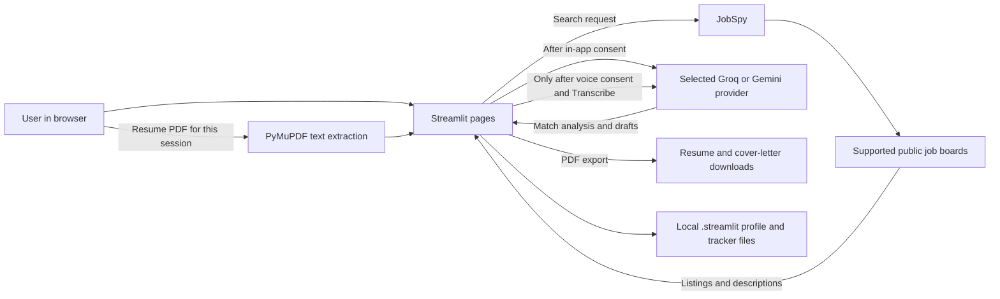

# Architecture and privacy notes

AutoApply is a local-first Streamlit app. It has no hosted API of its own: the browser connects to the Streamlit process running on the selected computer.

## Where information goes

| Information | Destination | Persistence |
| --- | --- | --- |
| Resume PDF and parsed resume text | Active Streamlit session; selected AI provider after consent for AI features | Not written to the app's profile/tracker files |
| Job search query | JobSpy and the selected external job sources | Depends on those services; searches happen when requested |
| Career preferences and saved roles | `.streamlit/career_profile.json` and `.streamlit/application_tracker.json` | Local files on the app machine |
| AI provider key saved by the user | `.streamlit/secrets.toml` | Local file; ignored by Git |
| Voice recording | Uploaded to the Streamlit process and sent for transcription only after separate consent | App does not write recordings to disk |
| Generated resume/letter | Streamlit session and the user's download location | Not stored as a server-side account document |

## Trust boundaries

- Job descriptions, resumes, and spoken audio are source data, not instructions to the model.
- The matching percentage is based on recognized text terms. It is not an employer's score and does not claim to predict screening outcomes.
- A missing term is not added to a resume unless the user provides supporting evidence and confirms it is accurate.
- The apply action opens an employer page. The user reviews and submits the application there.
- Local `secrets.toml` is convenient for a demo but is not a hosted secrets manager. Keep it private and use deployment-managed secrets for any hosted instance.
